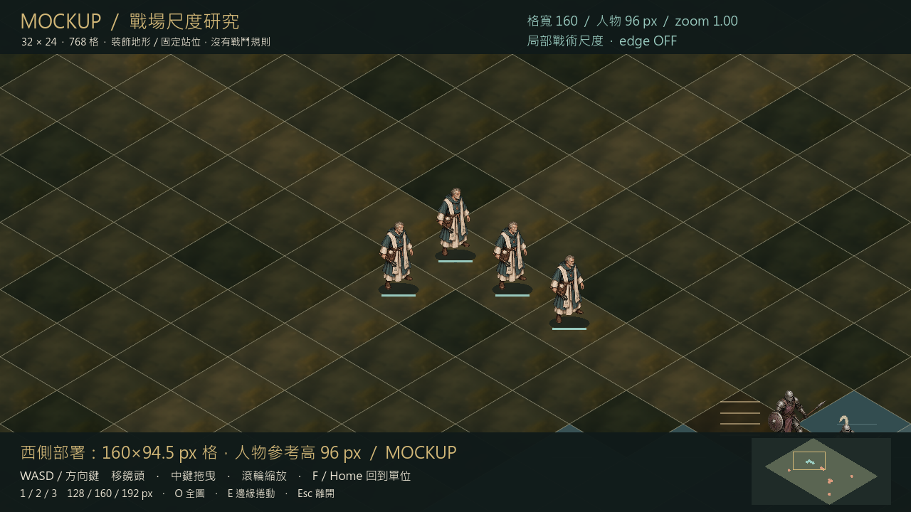

# 大地圖提案：大格子、可捲動的戰場

**PROPOSED／待 Gavin 選案，2026-10-24。** 依 spike-03 brief，這份文件與獨立
mockup 只用來比較視野和製作成本，不改正式關卡、戰鬥規則、故事或 G005。
目前 Godot 戰鬥仍是 11×9；React／Phase B 已取消，不列為遷移目的地。

建議先選 **C：保留菱形投影，160×94.5 px 的大格子，32×24 標準戰場**。
角色參考高度約 96 px，是現況約 48 px 的兩倍。這能先驗證「鏡頭只看見戰場
一部分，人物仍清楚」的需求，保留既有角色與投影方法。這是建議，並非 Owner
決策，也沒有授權把本輪 mockup 接入遊戲。

## 目標與現況

曹操傳式的參考感受是：地圖比畫面大、部隊在路線與據點間行軍、玩家移動鏡頭
閱讀局勢，格子與人物不必為了整張地圖縮進一個畫面。只參考感受；不複製其
地圖、畫面、人物、素材、數值或關卡。

目前 `skirmish.gd` 的菱形格寬約 82.72、高約 48.88 px；11×9 共 99 格，
整體約 827×489 px。參考人物高度約 48 px。底圖是一張繪畫加少數 props，
不是可拼接 tile set；Camera2D 固定，沒有戰場捲動或敵方回合。

大地圖不是把現有底圖拉大。它會改變抵達目標所需回合、戰線長度、增援可見性
及美術拆分方式。這些都須下一輪明確授權與玩家驗證。

## 三個可選方案

| 方案 | 格子／標準地圖 | 人物參考高 | 好處 | 實際代價與可見結果 | 粗估工程量／主要風險 |
| --- | --- | --- | --- | --- | --- |
| A 保守擴圖 | 菱形 128×75.6 px；24×18（432 格） | 76 px | 保留投影、人物與手繪方向；視野較寬 | 比現況大約 1.6 倍，但遠看仍可能偏小；需拆分地景 | 4–7 工程人日；可能仍達不到 Owner 的人物閱讀目標 |
| B 方格三分之四視角 | 方格 footprint 80×80 px；32×24（768 格） | 約 88 px | 上下左右與地圖方向直觀；更接近所述參考感受 | 投影、環境透視、遮擋、拾取格位與方向動畫須重估；舊菱形繪畫不能直接當方格地景 | 8–14 工程人日；另需完整環境風格試作，舊美術重用率最低 |
| **C 大格菱形（建議）** | **160×94.5 px；32×24（768 格）** | **96 px** | 大人物；延續現有暗黑奇幻手繪和投影 | 畫面看見更少格子，必須有可靠捲動、離屏提示和總覽；大圖仍需重做地景 | 5–9 工程人日；遮擋／大圖節奏與美術分塊是主要風險 |

人日是單一有經驗實作者的初步規劃估算，非承諾或報價，誤差至少 ±50%；
涵蓋鏡頭、地圖資料適配、導航／HUD 與一張灰盒驗證，**不包含**正式 AI、關卡
平衡、完整戰役、量產美術、方向動畫或人類測試排程。C 的 32×24 不是每關下限。
若 Gavin 更重視參考作品的方格方向感，應先選 B 的透視試作，再決定生產管線。

## 視角與格子尺寸

保留菱形的優點是沿用 `center()` 的世界座標、四鄰接邏輯、腳底 pivot 與目前
角色構圖。缺點是畫面斜向與格子軸不同，靠相鄰兩格的單位會重疊；樹木與高台
需要前後分層、遮擋淡出及明確格線。正式地圖必須能讀懂可走區，不能依底圖顏色
猜規則。

改成 top-down／3/4 方格後，棋盤座標與畫面方向較一致，矩形城牆、巷道與區域
邊界較直觀；但角色朝向、站姿透視和手繪場景都需重新驗證。方格是 footprint，
不等於把角色改成俯視小點，也不等於沿用菱形繪畫再加方格線。

以 1280×720 參考畫布，預留上方資訊與下方操作區；假設有效戰術區約
**1176×500 px**（x=52…1228，y=88…588）。側邊面板展開時還會更少，
應可收起。菱形寬高比維持既有 44:26，以下 64／80／96 是**半寬**，不是格高。

| 尺寸試算 | 實際寬×高 | 畫面橫向／縱向完整外框數 | 面積估算可見格中心數 | 人物參考高 |
| --- | --- | --- | --- | --- |
| 菱形半寬 64 | 128×75.6 px | 約 9.2／6.6 | 約 121 | 76 px |
| **菱形半寬 80** | **160×94.5 px** | **約 7.4／5.3** | **約 78** | **96 px** |
| 菱形半寬 96 | 192×113.5 px | 約 6.1／4.4 | 約 54 | 114 px |
| 方格 64 | 64×64 px | 約 18.4／7.8 | 約 144 | 約 72 px |
| 方格 80 | 80×80 px | 約 14.7／6.3 | 約 92 | 約 88 px |
| 方格 96 | 96×96 px | 約 12.3／5.2 | 約 64 | 約 104 px |

菱形可見格估算用 `可用面積 ÷ (格寬×格高÷2)`，不是「9 列×6 行」；
實際完整格數取決於鏡頭位置、邊緣裁切和 HUD，不能把估算當逐格實測。
角色高度以 reference_height=360 的原始 PNG 計算，各姿勢實際輪廓略有差別。

1080p 建議先採同視野的 1.5 倍畫布縮放：C 格子約 240×141.8 px、角色約
144 px、HUD 也放大，看到同樣範圍。之後若提供「更多戰場」模式，應另測文字
與點選大小，不能默默縮小角色。地圖 zoom 與 UI 縮放分開。

## 地圖種類、單位量與節奏（全部是待驗證假設）

| 類型 | 提議尺寸 | 我方／敵方同時在場 | 目標節奏 |
| --- | --- | --- | --- |
| 小型遭遇／教學 | 16×12；L03 可保留 11×9 | 4–6／6–10 | 5–8 回合，約 10–18 分鐘 |
| 標準野戰 | 24×18 至 32×24 | 6–8／10–16 | 8–12 回合，約 20–35 分鐘 |
| 城塞／大型會戰 | 32×24 至 40×30 | 8–10／16–24，分組啟動 | 10–16 回合，約 30–50 分鐘 |

時間包含思考，尚無人類測試支持。不是「越大越好」：32×24 的角落距離最多
54 個四鄰接步，若未來移動力假設為 5，也要約 11 回合，還沒算河流與阻擋。
主要交戰或下一個有意義目標宜距部署區 8–15 步，路線上每 2–4 回合有局勢
變化。避免十回合空走後才開始戰鬥。

## 鏡頭與離屏資訊

建議鍵盤 WASD／方向鍵平移，Home／F 回到選中單位，空白鍵沿用當前操作，
不拿來平移以免和確認攻擊衝突。游標靠邊 16 px 捲動可關閉；中鍵或右鍵拖曳
要先辨別取消操作，不吞掉戰鬥指令。操作選項需可重綁，mockup 僅驗證基本機制。
滾輪 zoom steps 建議 0.8／1.0／1.2／1.5，以游標或畫面中心為穩定錨點。
全圖 overview 獨立按 O，屬閱讀模式；不能讓 20 px 高的小人成為主要操作尺度。

正式實作建議分成 camera base position、attack focus、impact offset 三層：
平移與 bounds 決定基準；攻擊前存下當時位置和 zoom，聚焦兩名角色；結束後回到
**攻擊前位置**，不能再硬回 (640,360)。spike-03 的方向 shake 只寫 offset；
zoom punch 疊在 attack zoom 上。放大後要重新計算 viewport half extents，
先 clamp base/focus，再限制邊緣 shake，避免抖出地圖。選取／預覽期間玩家平移
應保留，攻擊期間暫停鏡頭控制，HUD 與 Esc 仍可操作。

換到我方活動單位時柔和跟隨；敵方回合只跟隨可見且有影響的行動。離屏攻擊或
增援先標示事件位置與來源，再短暫 snap／pan，不能在玩家讀資訊時無預告搶走
鏡頭。Reduced Motion 改直接定位事件、關閉 shake／zoom punch；保留手動捲動。
無事件時不自動漂移。邊界以地圖世界範圍 clamp；不規則河岸可有背景留白，
但不准把可操作格子永久卡在 HUD 後面。

角落小地圖建議顯示 terrain 簡圖、我敵方點位、viewport 框與目標；可點擊移鏡
頭。它是輔助，不能代替可讀的大地圖。離屏目標用有標籤的 edge arrows，
不可只靠紅綠色區別。

## Fog、區域與資訊公平

建議第一版**無 fog of war**，先把鏡頭／導航／敵方意圖做清楚。分區啟動敵軍
不等於隱形敵人：部署前可看目標、道路、已知部隊與增援入口。若日後採 zone
reveals，進區前應說明哪些情報未知、觸發邊界及退路；不要在無提示的位置突然
生成能立刻攻擊的敵人。

若未來要 fog，另行設計視線、記憶狀態、離屏事件與 AI 公平性。不能只加黑遮罩
而讓 AI 仍用玩家看不到的全知資訊。是否 fog 仍由 Gavin 決定，本輪不實作。

## 關卡設計如何改變

部署區應能讓全隊在 1–2 回合展開，至少有主路與一條代價不同的側路，避免唯一
窄橋把更多單位變成排隊。側路提供位置或補給優勢，但要用額外步數、暴露回合
或離開主要目標的代價交換；選路前在畫面上可看見地形與已知威脅。

| 要素／選擇 | 玩家事前知道 | 實際代價 | 後續可見結果 |
| --- | --- | --- | --- |
| 主路／側路 | 距離、道路、已知敵群、目的地 | 側路多走 1–2 回合；主路較快但正面接敵 | 鏡頭與地圖上可見抵達位置、交戰角度或落後隊員 |
| 預告增援 | 到達回合／觸發條件、入口箭頭、預估兵種；至少提前一回合 | 留兵守入口或放棄當前推進 | 新部隊從邊緣進場；不在玩家背後無預警立即出手 |
| 守點／追擊 | 守點所需回合與領袖撤離路線 | 分兵會降低另一線承受力 | 回合計數、佔領狀態與撤離進度明確變化 |
| 護送／抄近路 | 護送對象速度、危險區、可用迂迴路 | 保護隊形耗回合；抄近路曝露隊伍 | 護送者位置與已知威脅距離可讀，不藏失敗條件 |

清場（rout）適合小圖；大圖應考慮抵達、守住、護送、擊敗領袖等目標，避免最後
花多回合找一個離群敵人。目標、撤退與失敗條件須在開場可讀；若增援或事件
改變條件，先顯示變更理由與新計數。以上是玩法提案，不是正式故事或關卡腳本。

## 平衡、導航與 AI 影響

目前 `grid_rules.gd` 是 **四鄰接 BFS**，不是「移動力 4」；獨立 spike 的
move 只有可達性，沒有正式每回合步數或地形成本。不可把擴圖等同於把現有
移動數值乘二。未來可先灰盒比較 4／5／6 步移動，但必須另訂規則並獲授權。

大圖讓遠程與威脅範圍影響更多接敵距離；需要可切換 enemy threat overlay，
顯示「本回合能走到哪、走完能打到哪」，避免投影造成的錯覺。UI 的攻擊預覽
要和同一規則事件一致。遠程、地形加成與正式暴擊本輪均未新增。

32×24 只有 768 格，單次 BFS 的 O(V+E) 不大；但每名敵人對每格每目標重新尋路
會累積。建議將格位以整數 index 儲存、共用距離圖、占位變動後才失效；有權重
地形再評估 Dijkstra／A*。不要因為要大圖就直接換掉可測的規則層。

現在沒有正式敵方 AI。未來應先有可解釋的分組警戒／接近／守點，接近範圍與
目標優先序對玩家可讀；避免所有遠處敵人同時逐格追逐，或為了縮短時間直接
瞬移。大量敵方回合可提供 2×／4×、跳過純移動動畫及事件摘要；涉及傷害與目標
改變仍要能回看。以 24 個敵人每個 1 秒計，光動作就 24 秒，還不含尋路與鏡頭；
因此同時啟動數和敵回合速度必須一起設計。上述成本推算不等於效能實測。

## 地景美術管線

| 管線 | 優勢 | 成本與風險 |
| --- | --- | --- |
| 單張整圖繪畫 | 統一筆觸、構圖容易控制 | C 圖外框約 4480×2647 px；現有 940×627 底圖硬放大會模糊，也無法處理獨立遮擋與後續改路 |
| Tile set + props | 可重排、同一 atlas 易批次繪製 | 接縫、道路轉折與重複感需專門畫；菱形／方格資產不同，AI 單張生成不保證可無縫拼接 |
| **Hybrid（建議）** | 底層邏輯格 + 可重用地面 tiles／painted chunks + 獨立樹木橋樑 | 需固定透視、光向、接縫與地標定位；地形規則須來自資料，不從 AI 繪畫推斷 |

建議同一暗黑奇幻手繪方向，先做一組地面、岸線、路口和遮擋樹的最小樣本；
AI 可生成材質候選與區塊草稿，但要用共同色稿、固定光向／比例／俯角，人工修
接縫並核對格位。AI 生成不構成最終美術驗收。人物方向與環境投影一起檢查；
本輪 A9 swing 仍為 PLACEHOLDER，不藉擴圖重畫或改旗標。

以 8×8 格邏輯區塊切 C 圖約需 4×3=12 塊；假設每塊含重疊邊為 1536×1024
RGBA8，未壓縮共約 72 MiB（不含 props、人物、mipmap／重複載入）。這只是
預算試算，尚未量產或量測。區塊坐標與主地圖共用，路口不能在拼接處錯位。

## 效能與 AMD 780M／GL Compatibility

本輪實際擷取在 AMD Radeon 780M、GL Compatibility 上執行，沒有證明大型正式
戰鬥已達標。後續建議先訂 720p／1080p 的 60 FPS 目標，再以 profiler 實測
frame time、draw calls、CPU 導航與記憶體峰值；不能用 build 或 mockup 載入成功
推論 40×30 大戰已驗收。

Godot 官方的 [TileMapLayer](https://docs.godotengine.org/en/stable/classes/class_tilemaplayer.html)
提供單層 tile map，會批次更新，rendering quadrant 可將 tiles 分組繪製；Y-sort
會改變分組方式。正式地景宜用 atlas／少量 layers 或 painted chunks，避免每格
各有 material、粒子與持續 script。獨立 props 依 y 排序，遠處遮擋或離屏節點
停更；畫外粒子不生成，鏡頭附近命中才展示。高頻連續戰鬥可再用小型 pool，
這次單擊 spike 保留一次性 emitter 清除測試。

768／1200 個邏輯格本身不是主要圖形負擔；多材質、透明 overdraw、全圖大紋理
與同時數十個特效才須量測。捲動時 culling 以 viewport + 特效外擴邊界判斷，
但規則與敵方 AI 不可因畫外就跳過結算。mockup 使用簡單繪製，**不代表**
TileMapLayer、culling 或 production art pipeline 已完成。

## L03 與既有關卡的遷移建議

建議 **L03 保留 11×9 作小型教學**，先以新鏡頭尺寸觀察，不拉長任務。
現有絞盤 (2,1)、渡口、河流、兩條故事後果與 G005 資料維持原位／原義。
本輪連鏡頭接入都未做，既有 spike 開放／友軍阻擋／地形阻擋仍照舊。

若下一輪要把 L03 變大，有兩種額外代價：等量擴邊會增加無意義步行；重建
路線則會改變絞盤抵達、橋被破壞後可達性與勝負條件。應用新關卡 ID 做灰盒，
保留舊關作對照，逐條驗證兩分支、可選同伴缺席、目標可達、撤退與增援條件。
不能把裝飾性 mockup 直接當 L03 重製版。

待 Owner 選案及授權後，建議分段：鏡頭與座標適配 → 一張純導航灰盒與可見格
測量 → 部署／威脅／離屏提示 → 一張有完整勝敗與敵方回合的測試戰鬥 → 人類
節奏測試 → 小批地景樣本與效能驗證。每段核對規則與美術成本；本輪沒有自動
接續這個遷移計畫的權限。

## Throwaway mockup 的問題與停止條件

獨立場景 `godot-spike/scenes/mockups/BigMapMockup.tscn`，不在 main scene 引用鏈，
不讀戰鬥 rules、不接真實 HUD 或關卡。使用自製 placeholder 菱形地面與既有
idle sprites；清楚標示 MOCKUP。只回答：「160 px 格／96 px 人物在大圖捲動時
是否值得深入？」視覺不是可玩關卡，也沒有地形可通行性承諾。

W5 已補全圖 overview、三個捲動位置，以及 128／160／192 px 格寬對照。
保留條件是可讀人物、可穩定定位與 clamp、不遮住核心戰術區；若遮擋嚴重，
先縮小到 A 或另做 B 透視試作。模型檢查只驗證畫面與機制，人類選案仍待定。
不讓 mockup 逐步變成未授權的正式大圖系統。

| 實機畫面 | 用途 |
| --- | --- |
| [全圖 overview](big-map/overview.png) | 768 格的外框與兩個裝飾渡口；縮小至 zoom 0.19，非操作尺度 |
| [西側部署](big-map/scroll-west.png)／[中段渡口](big-map/scroll-crossing.png)／[東側](big-map/scroll-east.png) | 相同尺寸、相同地圖的三個不同鏡頭位置 |
| [格寬 128](big-map/tile-128.png)／[160](big-map/tile-160.png)／[192](big-map/tile-192.png) | 相同部署格；人物參考高實為 76.8／96／115.2 px |
| [擷取資料](big-map/capture.json)／[操作與限制](big-map/README.md) | 真實尺寸、camera/zoom、鍵鼠與 clamp 驗證 |

模型檢視：人物比原 spike 大，三種尺度可比較；灰盒重複地面與簡單橋紋理顯然
不是最終美術。總覽人物刻意很小，近景才是建議操作尺度。現有地形沒有高物件，
因此尚未驗證樹木遮擋、完整威脅資訊或多單位交戰。人類閱讀與選案仍待 Gavin。

## 給 Gavin 的待決問題（每題可一行回答）

1. 選哪個方向：A 菱形 128、B 方格 80、或 C 菱形 160（建議）？
2. 標準戰場先以 24×18 還是 32×24 驗證？
3. 人物參考高先定 76／96／114 px 的哪一級？
4. L03 是否保留 11×9 教學圖（建議），另做一張大圖灰盒？
5. 第一版是否全圖可見、無 fog（建議）？
6. 主要操作偏好 WASD＋中鍵拖曳，還是邊緣捲動為主？
7. 標準戰鬥希望約 15–20、20–35，或 35 分鐘以上？
8. 是否接受 hybrid 地景管線，先驗證少量 tiles／painted chunks？

以上是交接給 Owner 的決策題，本輪不等待回答而擴張實作，也不代填 Owner 決定。

## 方法與證據來源

資料基準：本分支 `20d9844`／A9 `b2f460b`，spike-03 brief、`skirmish.gd`、
`grid_rules.gd`、shared animation manifest；L03 React rules／README 僅唯讀核對，
沒有恢復其工作路線。本輪技術 API 另唯讀官方 Godot 文件（2026-10-24）。

清單指定的 [level-design](https://github.com/gamedev-skills/awesome-gamedev-agent-skills/blob/0a70cfc64672d512c5b5b6006b5dcb5cf90dbdbd/skills/disciplines/level-design/SKILL.md)、
[game-feel](https://github.com/gamedev-skills/awesome-gamedev-agent-skills/blob/0a70cfc64672d512c5b5b6006b5dcb5cf90dbdbd/skills/disciplines/game-feel/SKILL.md)、
[game-ui-ux](https://github.com/gamedev-skills/awesome-gamedev-agent-skills/blob/0a70cfc64672d512c5b5b6006b5dcb5cf90dbdbd/skills/disciplines/game-ui-ux/SKILL.md)
及 prototype-fast 方法僅用於資訊、路線、節奏與可丟棄驗證的檢查，沒有安裝、
複製程式或採用他作素材。成本、尺寸與節奏的推薦均為本企劃推論，未經人類驗收。
