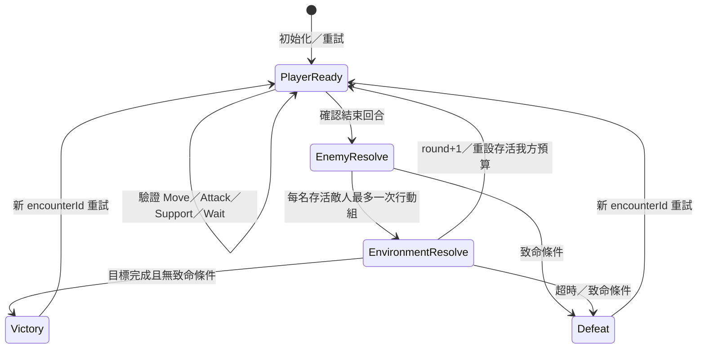

# Playable L03 v0.1：待核准 Demo 契約

**PROPOSED_NOT_AUTHORIZED。以下數值、部署、AI、目標及勝敗全是可修改的展示提案，沒有實作，不是正式故事、職業、D&D／SRD 或 G005 決策。** 保留目前 UI／ArtGate 與兩條完整展示流程；另設可辨識的 Playable Demo 入口。戰鬥結果不寫回正式故事、同伴信任或永久存檔。

## 單一世界座標

沿用 `l03Scene.sceneRows` 的 11×9、零起算 `(x=0…10,y=0…8)`、四鄰格。水不可走，森林與路面均成本 1；不加高度、斜走、機會攻擊、隨機命中或遠程穿牆。開閘時 `(4,4),(5,4)` 不可走；封閘時橋可走。分支在本次開局鎖定，切換分支必須明示重開。

所有地景、單位腳點、命中區、移動與目標都讀同一 MapDef。renderer 才做投影；相機反變換後的點擊要回到同一 cell，鍵盤直接操作 cell。禁止用 ArtGate 的螢幕錨點推斷通行。

為避免舊開局無解，兩分支皆提議以下**新的 Demo 部署**，而非修改既有故事部署。三名我方位於右岸；所有起點都須驗證可走、互不重疊、未占車隊格。

| ID／展示角色 | 起點 | HP／傷害／行動 |
| --- | --- | --- |
| karen／凱倫 | (7,3) | HP9；近戰3；移動3；一般支援 |
| lace／蕾絲 | (8,2) | HP7；近戰3；移動3；一般支援 |
| thoma／托瑪 | (9,3) | HP8；近戰3；移動3；支援回復3 |
| knight-a／匿名騎士 | (8,0) | HP6；近戰3；移動3；目標干擾型 |
| knight-b／匿名騎士（重用造型） | (10,4) | HP6；近戰3；移動3；目標干擾型 |
| crawler／爬行者 | (6,7) | HP8；近戰3；移動3；追擊弱點型 |

增加第二名騎士只是 Demo 壓力提案，不量產新角色美術。HP／敵數是否有趣、兩分支是否都可勝，須未來以 trace 與人類試玩證明，不能由起點合法就宣稱平衡通過。任何我方可占目標，不把關卡鎖在可選同伴身上；本輪完整陣容是測試 fixture，不決定正式出場名單。

## 玩家行動

每個存活單位每輪有 move=1、action=1；玩家可交錯選人，先移後攻或先攻後移皆可。預覽／選取不消耗資源。

| 命令 | 合法性與結算 |
| --- | --- |
| Move | 一次走 1–3 格，整條路徑四鄰相連、可走，不穿過／停在任何存活單位或車隊；到目的地扣 move。原地為不消耗的取消預覽；無路回傳明確錯誤，不把 `[actor]` 當成功 |
| Attack | action=1，自己與敵人存活且相鄰（曼哈頓距離恰為1）；固定3傷害，HP下限0，扣action。沒有合併免費移動；傷害可預見 |
| Support | action=1；自己或相鄰存活我方 HP 未滿，回復2（托瑪3），上限maxHP；不能復活、不能治車隊；扣action。一般支援只是測試用急救，不設定正式職業 |
| Wait | 放棄該單位尚餘 move/action；可不攻擊地移動後待命 |
| EndPlayerTurn | 可以提早結束，尚有資源時顯示明確確認；收束所有我方未用資源，執行敵方→環境→判定。所有人用完仍保留明確「結束回合」，不自動偷跳 |
| Retry | 確認後新 encounterId、round1、原始部署／目標／HP／預算；清空選取與事件播放，分支不變；另提供重選分支 |

受擊倒地不再行動且不占格；已有屍體圖片僅是外觀。無防禦、法術、裝備、掉落、經驗或長期資源系統；後續若要加入須獨立設計，不能用動畫暗示已實作效果。

## 狀態機與唯一結算

領域資料至少有 encounterId、rulesVersion、revision、round、phase、variant、MapDef、units（HP／位置／每輪預算）、objective、outcome、已處理 commandId。畫面另有 selection／preview／focus／presentationQueue，不混在領域規則。

建議契約為 `resolve(state, command) -> {state, events, rejection?}` 的純 TS 邏輯。驗證同一 encounterId／expectedRevision／commandId、回合所有權、存活、占位、步數、範圍與剩餘預算；拒絕時不改狀態。重複 commandId 無副作用，舊 revision 明確拒絕並刷新預覽。事件攜帶 commandId／eventId、before/after、實際路徑、HP差值與原因。

EndPlayerTurn 以**有上限的同步領域交易**跑完敵方與環境，產生有序事件；中間 phase 記入 trace。敵方 ID 快照固定排序，每人最多一個 Move＋一個 Attack 或 Wait；最多處理開局存活敵數次，不能靠 await 動畫推進規則。交易最後儲存 PlayerReady／Result，演出可逐個呈現 before/after；整批重放不重新執行交易。

已接受命令就完成位置／HP／預算／目標結算；動畫只消費事件。預覽 Esc 可撤銷；確認後 Esc 是「跳過演出」，不回復 HP／回合。播放時控制列可暫鎖新命令但必須能立即跳過，佇列有總時限保險（每事件上限2秒）；Reduced Motion 可直接呈現結果。視窗切換／RAF暫停／組件卸載不會改變判定或卡在 EnemyResolve。

離開 Demo 預設結束該次 encounter，返回是新局；不宣稱持久保存。卸載清理 presenter、事件訂閱與計時器；Retry 更換 encounterId，舊回呼只能丟棄。領域結算不得由 onImpact、onTweenComplete、setTimeout 或 React effect 再扣 HP。這比現有 token 防重入多保證「即使完全不播放，也得到相同結果」。

## 兩種可解釋敵方策略

同一 planner 用於當前 intent 預覽與執行；intent 標示「按目前局面」，附 revision／目標／路徑／理由。玩家行動改變狀態後刷新，執行到下一個敵人前按新狀態重算；不假裝早先箭頭永久有效。全圖公開，無隱藏資訊或隨機選靶。

1. **騎士：干擾目標。** 封閘先攻相鄰車隊；其次攻相鄰我方（靠近當前分支目標優先，再比HP比例、ID）。否則朝絞盤距離≤1的可站位格（開閘）／車隊相鄰格（封閘）尋最短可行路，最多走3格；移後重驗相鄰攻擊。已占目標干擾位而無人可打就 Wait；無路則追最近可達我方，仍無路就 Wait。
2. **爬行者：追擊弱點。** 只在可找到合法相鄰落點的存活我方中，比 HP/maxHP 最低→到合法攻擊位的路徑長→ID；最多走3格，若移後相鄰則攻擊。無可達者 Wait，不穿河／穿人，不把車隊當生物目標。

尋路的目標是可站立的攻擊位，不是占用的敵人格。搜尋最多99格，鄰居固定右／下／左／上；同分格以 `(y,x)` 排序。目標、落點若因前一敵人改變而失效，重算一次；仍無合法行動就 Wait，記錄原因並前進。HUD 如「騎士欲截住車隊」「爬行者追擊蕾絲：HP比例最低」須來自 planner 的理由，不能是與實際 AI 無關的裝飾文字。

## 兩分支目標與環境反應

每輪依序玩家→敵方→環境。期限為第5輪環境結束；3–5分鐘是待人類量測的目標，不由5輪推論已達成。

| 分支 | 狀態與進度 | 成功／失敗 |
| --- | --- | --- |
| 開閘接船 | 絞盤(8,1)為可站立地標、不占格。環境階段若至少1名存活我方距離≤1，且沒有存活敵人距離≤1，接應進度+1；否則停滯並顯示缺少守位／敵人干擾。0…3依序對應三艘船靠岸，非純數字裝飾 | 進度3即成功；第5輪仍不足則失敗。開閘橋斷，不再把車隊可過橋當作附帶獎勵 |
| 封閘護送 | 車隊HP6、占1格、不可治療，起點(8,4)。固定路徑(8,4)→(7,4)→(6,4)→(5,4)→(4,4)→(3,4)→(2,4)。環境開始至少1名存活我方與當前車隊距離1才可前進，每輪最多2格；逐格檢查無單位占據、無存活敵人鄰接下一格、地形可走，遇阻停在最後合法格；沒有護送者則不動 | 活車隊抵達(2,4)成功；HP0或第5輪未抵達失敗。不因殺光敵人跳過護送 |

共通失敗：凱倫 HP0 或我方全倒，立即終局；這是可改的 Demo 敗北條件，不寫新死亡劇情。每個傷害事件後先查致命條件；未終局才進環境。環境只結算一次：先查致命→進度→目標成功→第5輪逾期→下一輪。第5輪完成目標算成功；致命與達標同批事件先算失敗。outcome 鎖定後禁止額外行動與再結算。

洪水壓力先由明示的回合期限、橋分支與目標阻擋呈現，不增加逐格淹水或暗骰。三船／車隊用原創簡化物件與進度標記，不從烘圖辨識「是否真的救到」。本 Demo 的成功／失敗與既有 K1 代價分層：沿用現有 gatePlans 的開閘救提歐／失橋與筆記、封閘保筆記／最後一船失聯說明；**成功不解除原選擇代價，失敗只導向本次重試，不創作正式新結局。**

## 可讀的最小畫面

上緣只保留目標、回合/5、當前階段；側邊可收合角色HP、move/action與敵意圖；下緣獨立 Move／Attack／Support／Wait／EndTurn。棋盤清楚呈現合法格、路徑、目標範圍、車隊下一步與停滯原因；敵我加形狀與文字，不只顏色。確認前列實際傷害／回復與資源代價。

Tab 依序切區／角色／操作；方向鍵移格、Enter選取／確認、Esc撤預覽或跳演出；dialog焦點受控且返回觸發鈕，不把鍵盤輸入穿透到底圖。720p以流式HUD和收合面板避免遮目標；1080p保持同一規則與座標。先有正確回饋，後續美術品質另驗，不能再以build代替美術或樂趣通過。
